<!-- Badges : syntaxe, styles et encodage des URL shields.io
     https://github.com/badges/shields
     espace = %20 · barre verticale = %7C · tiret littéral = -- · plus = %2B
     « langues » désigne l'interface du plugin, traduite en 5 langues. -->

<div align="center">

# Magic Search


**Une seule barre pour tout retrouver dans QGIS : une adresse, un numéro de regard, une parcelle ou des coordonnées**

[](https://qgis.org)
[](#-qgis-3-et-qgis-4)
[](metadata.txt)
[](LICENSE)
[](#-langues--languages)
[](#-prérequis)

**[Français](#-français) · [English](#-english) · [Español](#-español) · [Português](#-português) · [Deutsch](#-deutsch)**

</div>

---

<div align="center">

## Aperçu rapide · Quick Overview

| Barre flottante · Floating bar | Recherche par mots · Word search | Panneau ancrable · Dockable panel |
|:---:|:---:|:---:|
| 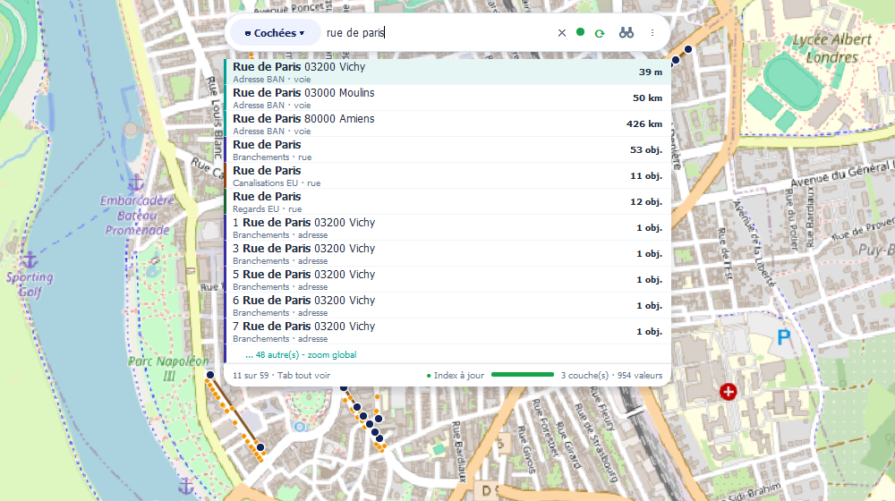 | 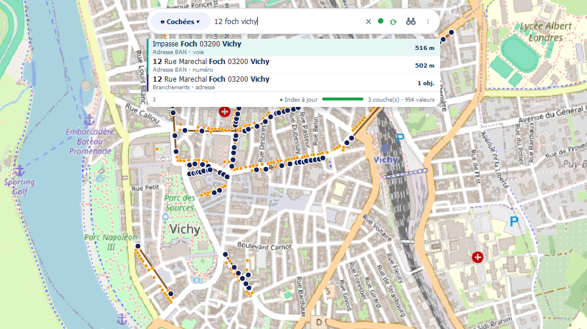 | 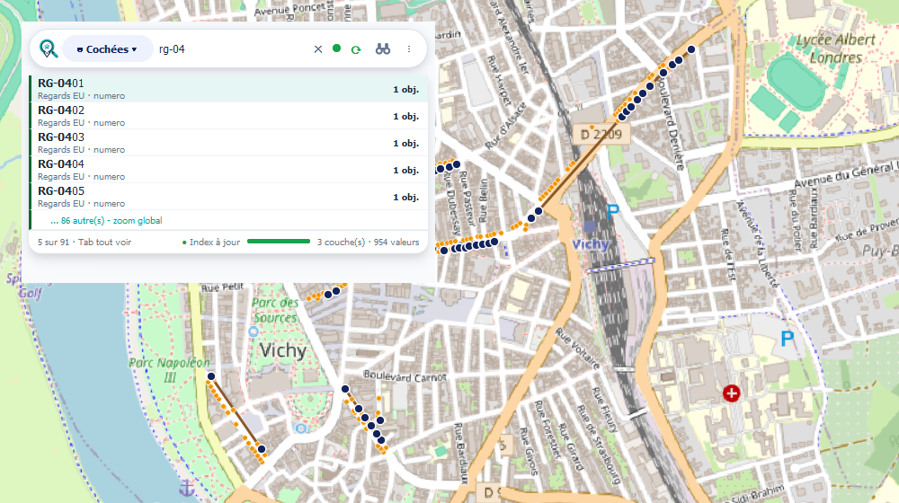 |
| Adresses BAN et valeurs des couches<br>dans une seule liste<br>*BAN addresses and layer values in one list* | Tous les mots, dans n'importe quel ordre<br>*All words, in any order* | Même pilule, même liste, logo en tête<br>*Same pill and list, logo in front* |

| Surbrillance au survol · Hover highlight | Adresse au clic · Address at map click | Vue de rue · Street view |
|:---:|:---:|:---:|
| 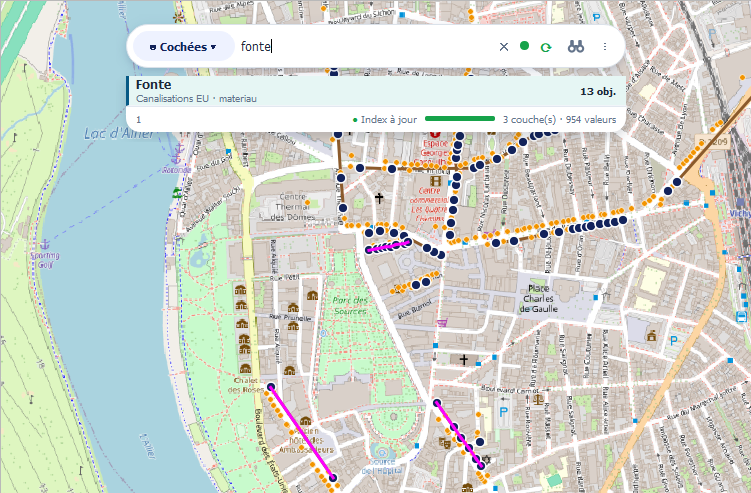 | 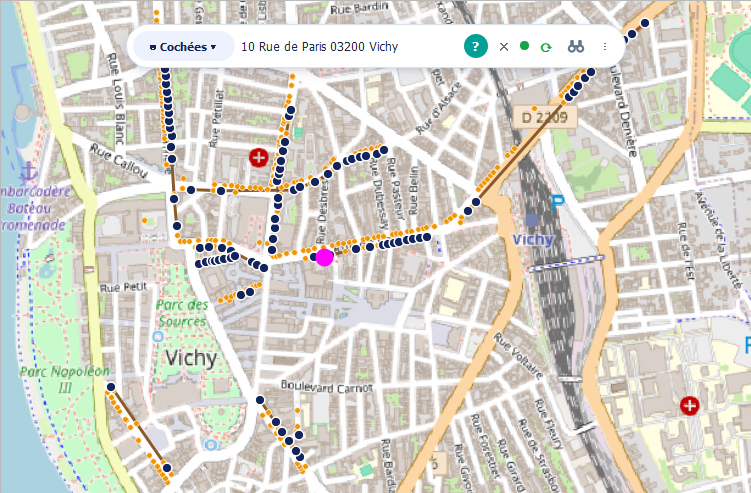 | 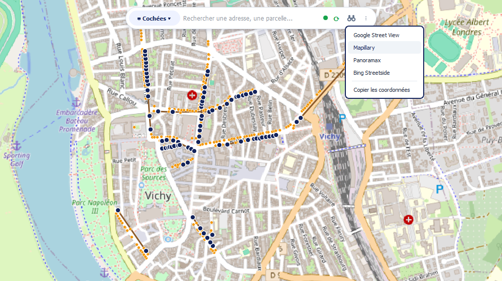 |
| Les 13 tronçons en fonte s'allument<br>*The 13 cast-iron sections light up* | Repère sur la carte, adresse BAN dans la barre<br>*Marker on the map, BAN address in the bar* | Google Street View, Mapillary, Panoramax, Bing<br>*Pick a service, then click the map* |

<sub>Données réseau fictives posées sur de vraies adresses BAN de Vichy · fond de carte © contributeurs OpenStreetMap<br>Fictitious network data placed on real BAN addresses in Vichy · basemap © OpenStreetMap contributors</sub>

</div>

---

## 🇫🇷 Français

## 📝 Description

**Magic Search** ajoute à QGIS une barre de recherche unique, celle qui manque quand on travaille sur un réseau ou un fond cadastral : vous tapez, et le plugin interroge **en même temps** le géocodeur d'adresses (BAN pour la France, OSM/Nominatim pour le reste du monde) et **tous les champs de toutes les couches vectorielles** du projet. Les résultats arrivent groupés par source, la géométrie s'allume au survol, un clic zoome dessus.

Fini l'aller-retour entre la table attributaire, le filtre par expression et un onglet de navigateur ouvert sur une carte d'adresses : une seule zone de saisie accepte une adresse (`12 rue de Paris`), une valeur métier (`RG-0421`, un numéro de branchement, un nom de parcelle) ou des coordonnées brutes (`45.123, 3.456` en WGS84, `652461, 6862050` en Lambert 93). Le plugin devine de quoi il s'agit et vous emmène au bon endroit.

Le coût de cette recherche instantanée est payé une seule fois, et quand vous le décidez : l'indexation ne démarre jamais toute seule, elle se lance sur un clic du bouton de synchronisation de la barre. Ce bouton dit d'un coup d'œil où en est l'index - rouge si aucune couche n'est indexée, orange si l'indexation est incomplète (couche ajoutée, passe interrompue), vert quand tout est à jour. Une fois lancé, le parcours se fait en tâche de fond sans bloquer l'interface, et l'index est conservé dans un cache compressé posé à côté du fichier projet : la synchronisation suivante ne reconstruit que les couches modifiées depuis.

### 🗂️ Sommaire

- [Aperçu rapide · Quick Overview](#aperçu-rapide--quick-overview)
- [⚙️ Fonctionnalités](#-fonctionnalités)
- [🖥️ Les deux interfaces](#-les-deux-interfaces)
- [🔎 Les boutons de la barre](#-les-boutons-de-la-barre)
- [⌨️ Utilisation](#-utilisation)
- [🛠️ Configuration](#-configuration)
- [🗃️ Indexation et cache](#-indexation-et-cache)
- [🔄 QGIS 3 et QGIS 4](#-qgis-3-et-qgis-4)
- [🚀 Installation](#-installation)
- [📋 Prérequis](#-prérequis)
- [🌍 Langues · Languages](#-langues--languages)
- [🏗️ Architecture](#-architecture)
- [🧪 Tests](#-tests)
- [📜 Changelog](#-changelog)
- [👤 Auteur](#-auteur)

---

## ⚙️ Fonctionnalités

| Fonctionnalité | Ce qu'elle fait |
|---|---|
| **Recherche adresses BAN** | Géocodage des adresses françaises via l'API officielle `api-adresse.data.gouv.fr`, avec filtre optionnel par code postal |
| **Recherche adresses OSM** | Géocodage mondial via Nominatim (OpenStreetMap), quand le projet sort de France |
| **Géocodeur injoignable signalé** | Sans réseau, sans réponse au bout de 10 s ou sur erreur du service, une ligne **⚠ BAN indisponible** prend la place des adresses et en donne la cause, au lieu d'une liste qui ressemble à une recherche sans réponse |
| **Recherche dans les couches** | Recherche instantanée dans tous les champs de toutes les couches vectorielles du projet, sans écrire une expression |
| **Recherche par mots** | Tous les mots, dans n'importe quel ordre : `chatel step` trouve « STEP Chatel Montagne ». Tirets, apostrophes, barres, points et parenthèses sont ignorés, chaque mot est surligné |
| **Recherche de coordonnées** | Saisissez `45.123, 3.456` (WGS84) ou `652461, 6862050` (Lambert 93) : le plugin reconnaît le format et zoome |
| **Géocodage inverse** | Menu **⋮ → Adresse au clic sur la carte** : cliquez sur la carte, l'adresse BAN la plus proche (rayon configurable, 25 m par défaut) s'affiche dans le champ ; une puce **?** rappelle que l'outil est actif |
| **Vue de rue** | Bouton **jumelles** : Google Street View, Mapillary, Panoramax ou Bing Streetside s'ouvrent dans le navigateur sur le point cliqué — ou copie des coordonnées (WGS84 + Lambert 93) |
| **Favoris** | Enregistrez les points récurrents (un regard, une vanne, un poste) et revenez dessus en un clic |
| **Historique** | Les 5 dernières recherches, rappelées depuis le menu **⋮** |
| **Aperçu géométrie** | Surbrillance de l'objet au survol du résultat, zoom au clic |
| **Clavier** | **↑ ↓** pour parcourir la liste, **Entrée** pour zoomer, **Échap** pour la fermer, **Tab** pour afficher plus de résultats |
| **Classement par distance** | Adresses et coordonnées classées par distance au centre de la carte : `rue de Paris` tapé depuis Vichy donne d'abord celle de Vichy |
| **Indexation incrémentale** | Jamais bloquante : la recherche fonctionne déjà sur les couches prêtes pendant que les autres se chargent |
| **Cache compressé** | Index conservé à côté du `.qgz`, avec empreinte par couche : seul ce qui a changé est reconstruit |
| **Indexation à la demande** | Rien ne part tout seul : le bouton **⟳** de la barre déclenche la passe et affiche l'état de l'index par sa couleur |
| **Périmètre de recherche** | Puce **◉ Cochées ▾** à gauche de la barre : ne répondre que sur les couches cochées, ou sur toutes, en un clic — les autres restent indexées |
| **Échelle de zoom** | Sur un résultat ponctuel : 1:200, 1:500 ou 1:1000, au choix |
| **2 styles d'interface** | Barre flottante posée sur le canevas, ou panneau ancrable |
| **QGIS 3 et QGIS 4** | Un seul code, de QGIS 3.16 (Qt 5) à QGIS 4 (Qt 6) |
| **5 langues** | FR, EN, ES, PT, DE — détection automatique depuis la locale QGIS, changement appliqué à chaud |

**Performance** — depuis la 1.5.0, l'index n'est plus un dictionnaire Python mais des colonnes compactes balayées en C. Sur un projet de **870 000 valeurs distinctes**, une frappe passe de **90-590 ms à 3-24 ms**, soit jusqu'à 25x plus rapide.

---

## 🖥️ Les deux interfaces

| Style | Description | Pour qui |
|---|---|---|
| **Barre flottante** | Barre posée sur le canevas, déplaçable et redimensionnable à la souris, opacité réglable de 10 % à 100 % | Ceux qui veulent la recherche sous les yeux sans perdre de place au bord de la fenêtre |
| **Panneau ancrable** | Panneau QGIS classique, ancré à gauche ou à droite comme les autres | Ceux qui travaillent avec une disposition de panneaux figée |

Le style se change à tout moment dans la configuration. Les deux partagent la même pilule de recherche et la même liste de résultats, donc exactement les mêmes fonctions ; le panneau affiche en plus le logo du plugin en tête de pilule.

---

## 🔎 Les boutons de la barre

La barre est une pilule arrondie. De gauche à droite :

| Élément | Action |
|:---:|---|
| **◉ Cochées ▾** | Périmètre de la recherche dans les couches : **couches cochées** ou **toutes les couches**. Le choix est mémorisé, comme la case correspondante de la configuration |
| **?** | N'apparaît que lorsque l'outil d'adresse au clic est actif ; un clic l'arrête |
| **✕** | Efface le champ de recherche |
| pastille + **⟳** | État de l'index et synchronisation. Leur couleur dit où en est l'index : **rouge** rien d'indexé (le glyphe devient **⚠**), **orange** incomplet, **ambre** passe en cours, **vert** à jour. Un clic sur **⟳** lance une passe |
| **jumelles** | Menu vue de rue : choisissez Google Street View, Mapillary, Panoramax, Bing Streetside ou « Copier les coordonnées », puis cliquez sur la carte |
| **⋮** | **Adresse au clic sur la carte**, **Favoris** (zoomer, ajouter, supprimer), **Recherches récentes**, **Configuration** et **Replier la barre** |

Les menus déroulants reprennent la charte de la barre (coins arrondis, survol turquoise) plutôt que le style Qt générique.

| Puce de périmètre | Menu ⋮ et favoris |
|:---:|:---:|
| 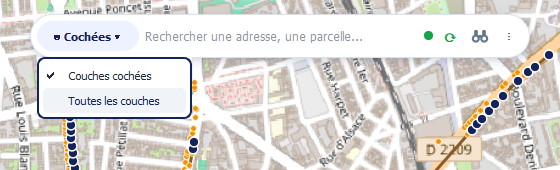 | 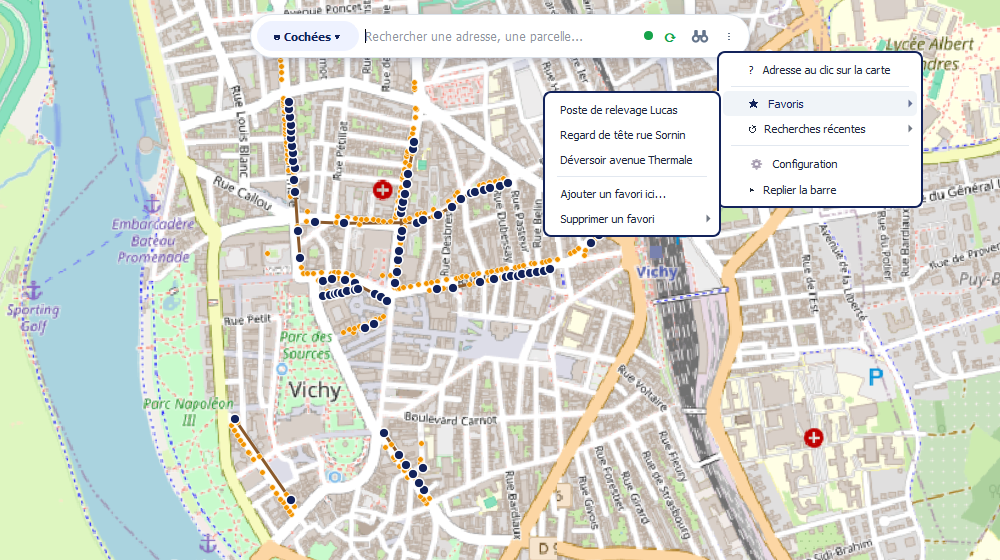 |
| Couches cochées ou toutes les couches | Adresse au clic, favoris, recherches récentes, configuration |

### La liste de résultats

Sous la pilule, une ligne par résultat : la valeur trouvée en gras, les mots cherchés surlignés, puis en gris la couche et le champ (ou le type d'adresse BAN : numéro, voie, lieu-dit, commune). Une bordure à la couleur de la source les distingue d'un coup d'œil — turquoise pour la BAN. À droite, la distance au centre de la carte pour une adresse ou des coordonnées, le nombre d'objets pour une valeur partagée par plusieurs entités.

Les coordonnées viennent en tête, puis les adresses, puis les valeurs des couches. Quand les résultats sont nombreux, les lignes et le texte se resserrent pour en montrer davantage, puis la liste défile. Le pied indique combien de résultats sont affichés, rappelle **Tab** pour tout voir, et montre l'état de l'index avec une jauge.

Une paire de nombres est lue comme des coordonnées, dans les deux sens (latitude, longitude ou l'inverse) : la lecture la plus proche du centre de la carte vient en premier.

Si le géocodeur ne répond pas, la liste le dit au lieu de rester muette : une ligne orange **⚠ BAN indisponible** (ou **OSM indisponible**) prend la place des adresses et en donne la cause — pas de connexion réseau, pas de réponse au bout de 10 secondes, ou erreur renvoyée par le service avec son code HTTP. Les valeurs des couches s'affichent normalement : la recherche dans le projet ne dépend pas du réseau. La ligne disparaît dès que le service répond de nouveau. L'adresse au clic suit la même règle : « BAN indisponible (pas de connexion réseau) » plutôt qu'un faux « aucune adresse à moins de 25 m ».

| Coordonnées | Géocodeur injoignable |
|:---:|:---:|
| 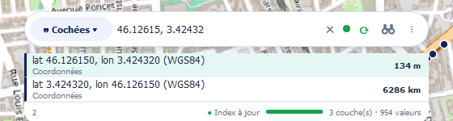 | 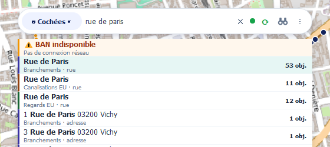 |
| Deux lectures, la plus proche en tête | La cause à la place des adresses, les couches répondent |

---

## ⌨️ Utilisation

1. Cliquez sur l'icône **Magic Search** dans la barre d'outils, ou appuyez sur **`Ctrl+Alt+F`**.
2. Tapez **au moins 2 caractères**. La recherche part à chaque frappe.
3. Les résultats s'affichent dans une seule liste : coordonnées, adresses (**BAN** ou **OSM**), puis valeurs trouvées dans les couches. Plusieurs mots se tapent dans n'importe quel ordre.
4. **Survolez** un résultat pour voir la géométrie s'allumer sur la carte, **cliquez** (ou **Entrée**) pour zoomer dessus.
5. Pour retrouver une adresse depuis la carte : menu **⋮ → Adresse au clic sur la carte**, puis clic sur le point voulu.
6. Pour ouvrir une vue de rue : bouton **jumelles**, choisissez le service, puis clic sur la carte.

> Astuce : un point que vous consultez souvent (poste de relevage, regard de référence) mérite un favori — menu **⋮ → Favoris → Ajouter**. Le zoom se fait ensuite en deux clics, sans rien retaper.

---

## 🛠️ Configuration

Accessible par le menu **⋮ → Configuration** de la barre.

<div align="center">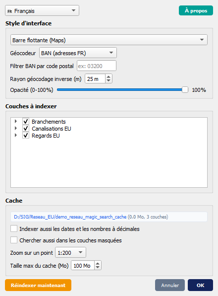</div>

| Réglage | Détail |
|---|---|
| **Géocodeur** | BAN (France), OSM/Nominatim (mondial), ou aucun |
| **Filtre BAN** | Restreint les résultats BAN à un code postal |
| **Rayon de géocodage inverse** | Distance maximale, en mètres, pour le bouton **?** (défaut 25 m) |
| **Couches et champs** | Cochez/décochez ce qui doit être indexé |
| **Périmètre de recherche** | Ne répondre que sur les couches cochées, sans cesser d'indexer les autres — le même réglage que la puce **◉** de la barre |
| **Zoom sur un point** | Échelle appliquée à un résultat ponctuel : 1:200 (défaut), 1:500 ou 1:1000 |
| **Dates et décimales** | Non indexées par défaut ; une case à cocher les inclut |
| **Cache** | Taille maximale (défaut 50 Mo) ; le chemin affiché est cliquable et ouvre le dossier |
| **Opacité** | De 10 % à 100 % (barre flottante) |
| **Style** | Barre flottante ou panneau ancrable |
| **Langue** | FR, EN, ES, PT, DE, ou suivi automatique de la locale QGIS |

Le style, la langue, le géocodeur, la taille de cache, le rayon, l'échelle de zoom et l'opacité sont mémorisés **globalement** : ils vous suivent d'un projet à l'autre. Les couches et champs exclus, ainsi que les favoris, restent **propres au projet**, puisqu'ils référencent ses couches.

---

## 🗃️ Indexation et cache

### Quand elle a lieu

Depuis la 2.0, **l'indexation ne démarre jamais d'elle-même**. Ouvrir un projet, ajouter une couche ou recharger le plugin ne fait que recalculer l'état de l'index ; c'est le bouton **⟳** de la barre qui lance la passe, et lui seul.

Ce choix vient de l'usage : sur un projet lourd ouvert pour une consultation rapide, une indexation automatique coûte du temps et des accès disque que personne n'a demandés. Le bouton porte donc l'état à lui seul :

| État | Bouton | Signification |
|---|:---:|---|
| `never` | pastille **rouge**, glyphe **⚠** | Aucune couche indexée — la recherche dans les couches ne répond pas encore |
| `partial` | pastille **orange** | Index incomplet : couche ajoutée, passe interrompue, exclusion levée |
| `syncing` | pastille **ambre** | Passe en cours, en tâche de fond |
| `complete` | **⟳** vert, sans pastille | Tout est à jour |

Une couche examinée mais sans aucun champ indexable n'est pas comptée comme manquante : sans cela le bouton ne repasserait jamais au vert.

### Ce qui est indexé

Par défaut, les champs **texte et entiers**. Sont écartés :

- les **dates** ;
- les **nombres à décimales** — on ne cherche pas une altitude au clavier ;
- les valeurs **NULL** et l'identifiant interne `fid` des GeoPackage et shapefiles (une clé primaire PostGIS, elle, reste indexée).

Les dates, si vous les incluez, sont indexées en ISO (`2024-03-01`) et au format français (`01/03/2024`). Les ligatures sont normalisées : `coeur` trouve « cœur ».

Avec une nuance qui compte sur des données réelles : beaucoup de sources (shapefiles, exports) typent en décimal des colonnes qui ne contiennent que des entiers, et ce sont souvent les champs métier qu'on cherche vraiment (numéro de regard, diamètre, contenance). Ces colonnes sont donc indexées, et abandonnées seulement si une vraie décimale apparaît — vérifié à chaque valeur, pas sur un échantillon.

Une même table chargée plusieurs fois dans le projet (copie d'une couche, couche d'étiquettes) n'est indexée, stockée et gardée en mémoire **qu'une seule fois** : l'index est adressé par son contenu (source, nombre d'entités, champs, exclusions), pas par la couche.

### Le cache

Un dossier `<projet>_magic_search_cache/` à côté du `.qgz`, contenant un `manifest.json` et un fichier `.idx` par index. Chaque `.idx` est un conteneur binaire (en-tête JSON + tableaux d'entiers bruts) compressé en LZMA.

Il est relu **couche par couche**, une par tour de boucle d'événements : l'interface reste utilisable pendant le chargement, et la recherche fonctionne déjà sur les couches prêtes. Un index dont l'empreinte ne correspond plus est reconstruit ; les autres sont repris tels quels — une synchronisation sur un projet inchangé ne coûte donc presque rien. L'empreinte tient aussi compte de la taille et de la date du fichier source : une valeur corrigée sans changer le nombre d'entités est bien détectée. Enregistrer des modifications sur une couche dans QGIS fait aussitôt passer l'index à l'orange.

Le format du cache est versionné : un cache produit par une version antérieure du plugin est purgé et reconstruit une fois.

### Structure de l'index

Un champ indexé n'est pas un dictionnaire de valeurs mais quelques blocs compacts :

| Bloc | Contenu |
|---|---|
| `hay` | Valeurs normalisées, concaténées et séparées par `\x00` |
| `starts` | Offset de chaque valeur dans `hay` (`array('i')`) |
| `orig` / `orig_starts` | Valeurs d'origine, seulement si elles diffèrent des normalisées |
| `fids` / `fid_starts` | Identifiants d'entités, à plat (`array('q')`) |

La recherche devient un `str.find()` sur une grande chaîne, exécuté en C, au lieu d'une itération Python sur des centaines de milliers de clés. Le séparateur `\x00` étant impossible à saisir, aucune correspondance ne peut chevaucher deux valeurs voisines.

Le coût de la compression se paie à l'indexation, jamais à la lecture : le codec est défini par `LZMA_PRESET` en tête de [`core/index_manager.py`](core/index_manager.py) et se change en une ligne.

---

## 🔄 QGIS 3 et QGIS 4

QGIS 4 repose sur **Qt 6**, là où QGIS 3 utilisait Qt 5. Magic Search 2.0 tourne sur les deux **avec le même code** : pas de branche séparée, pas de version à choisir au téléchargement.

Deux différences seulement demandaient un traitement.

**Les énumérations.** Qt 6 ne les expose plus à plat sur la classe : `Qt.ArrowCursor` devient `Qt.CursorShape.ArrowCursor`, `QNetworkReply.NoError` devient `QNetworkReply.NetworkError.NoError`, `QgsRubberBand.ICON_CIRCLE` devient `QgsRubberBand.IconType.ICON_CIRCLE`. La forme longue étant déjà valide sous Qt 5, le plugin n'écrit plus qu'elle.

**Les événements souris.** Qt 6 remplace `pos()` / `globalPos()` (QPoint) par `position()` / `globalPosition()` (QPointF). C'est le seul point qui demande du code, isolé dans [`core/qt_compat.py`](core/qt_compat.py) :

```python
def event_global_pos(event):
    """Position ecran (QPoint) d'un evenement souris, Qt 5 comme Qt 6."""
    global_position = getattr(event, 'globalPosition', None)
    if global_position is not None:
        return global_position().toPoint()
    return event.globalPos()
```

Le module interroge l'événement plutôt que la version de Qt : un Qt 5 recompilé ou un Qt 6 conservant les API dépréciées sont traités correctement dans les deux cas. Tout le plugin — déplacement et redimensionnement de la barre flottante, outils de clic sur la carte — passe par ces deux fonctions, couvertes par les tests.

Reste un détail d'import : `QAction` et `QShortcut` ont quitté `QtWidgets` pour `QtGui`. [`plugin_main.py`](plugin_main.py) tente l'import Qt 6 et retombe sur Qt 5.

> Le libellé du style d'interface passe de « Panneau ancrable (Qt5) » à « Panneau ancrable » — la mention n'avait plus lieu d'être. La préférence déjà enregistrée reste valable : l'identifiant interne, lui, ne change pas.

---

## 🚀 Installation

1. Téléchargez ou clonez ce dépôt :

   ```bash
   git clone https://github.com/Cartoyoyo/Magic_search.git
   ```

2. Copiez le dossier `magic_search` dans le répertoire des plugins QGIS :

   | Système | Chemin |
   |---------|--------|
   | Windows | `C:\Users\<utilisateur>\AppData\Roaming\QGIS\QGIS3\profiles\default\python\plugins\` |
   | macOS   | `~/Library/Application Support/QGIS/QGIS3/profiles/default/python/plugins/` |
   | Linux   | `~/.local/share/QGIS/QGIS3/profiles/default/python/plugins/` |

3. Ouvrez QGIS, allez dans **Extensions → Installer/Gérer les extensions → Installées**, cochez **Magic Search** et cliquez sur **OK**.

4. L'icône apparaît dans la barre d'outils. Raccourci : **`Ctrl+Alt+F`**.

> Le plugin est aussi disponible depuis le dépôt officiel : **Extensions → Installer/Gérer les extensions → Toutes**, puis recherchez « Magic Search ».

---

## 📋 Prérequis

| Dépendance | Statut | Usage |
|---|---|---|
| QGIS **3.16 à 4.x** | requis | le même code sous QGIS 3 (Qt 5) et QGIS 4 (Qt 6) |
| Connexion internet | optionnel | géocodage BAN / OSM uniquement ; la recherche dans les couches fonctionne hors ligne, et une ligne « BAN indisponible » signale l'absence de réseau |

**Aucune dépendance Python hors bibliothèque standard.** Rien à installer avec `pip`.

---

## 🌍 Langues · Languages

L'**interface du plugin** et **cette documentation** sont disponibles en cinq langues.

| Langue | Interface | Documentation |
|---|:---:|:---:|
| Français | ✅ | ✅ complète |
| English | ✅ | ✅ complète |
| Español | ✅ | ✅ condensée |
| Português | ✅ | ✅ condensée |
| Deutsch | ✅ | ✅ condensée |

Au premier lancement, le plugin suit la locale de QGIS. Le choix d'une langue dans la configuration prime ensuite sur celle de QGIS et s'applique **à chaud**, sans redémarrage : placeholders, infobulles, messages d'indexation et entrées de menu suivent immédiatement.

---

## 🇬🇧 English

> Screenshots are in the [Aperçu rapide · Quick Overview](#aperçu-rapide--quick-overview) section at the top of this document.

### 📝 Description

**Magic Search** adds a single search bar to QGIS: as you type, the plugin queries **at the same time** the address geocoder (BAN for France, OSM/Nominatim worldwide) and **every field of every vector layer** in your project. Results come grouped by source, geometry highlights on hover, a click zooms to it.

No more round-trips between the attribute table, an expression filter and a browser tab open on an address map: one input accepts an address (`12 rue de Paris`), a business value (`RG-0421`, a manhole number, a parcel name) or raw coordinates (`45.123, 3.456` in WGS84, `652461, 6862050` in Lambert 93). The plugin works out which is which and takes you there.

The cost of that instant search is paid once, and when you decide: indexing never starts on its own, it runs on a click of the bar's sync button. That button shows the state of the index at a glance - red when no layer is indexed, orange when indexing is incomplete (layer added, pass interrupted), green when everything is up to date. Once started, the pass runs in the background without blocking the UI, and the index is kept in a compressed cache stored next to the project file: the next sync only rebuilds the layers changed since.

### ⚙️ Features

| Feature | What it does |
|---|---|
| **BAN address search** | French address geocoding through the official `api-adresse.data.gouv.fr` API, with optional postcode filter |
| **OSM address search** | Worldwide geocoding through Nominatim (OpenStreetMap) |
| **Unreachable geocoder shown** | No network, no answer within 10 s or a service error: a **⚠ BAN unavailable** line takes the place of the addresses and gives the cause, instead of a list that looks like a search with no answer |
| **Layer search** | Instant search across every field of every vector layer, no expression to write |
| **Word search** | All words, in any order: `chatel step` finds "STEP Chatel Montagne". Dashes, apostrophes, slashes, dots and brackets are ignored, each word is highlighted |
| **Coordinate search** | Type `45.123, 3.456` (WGS84) or `652461, 6862050` (Lambert 93): the plugin detects the format and zooms |
| **Reverse geocoding** | **⋮ → Address at map click** menu: click the map, the nearest BAN address (configurable radius, 25 m by default) appears in the field; a **?** chip shows the tool is active |
| **Street view** | **Binoculars** button: Google Street View, Mapillary, Panoramax or Bing Streetside open in the browser at the clicked point — or copy the coordinates (WGS84 + Lambert 93) |
| **Favourites** | Save recurring points and jump back to them in one click |
| **History** | The last 5 searches, from the **⋮** menu |
| **Geometry preview** | Highlight on hover, zoom on click |
| **Keyboard** | **↑ ↓** to browse the list, **Enter** to zoom, **Esc** to close it, **Tab** to show more results |
| **Sorted by distance** | Addresses and coordinates sorted by distance from the map centre: `rue de Paris` typed while looking at Vichy gives Vichy's first |
| **Incremental indexing** | Never blocking: search already works on ready layers while the others load |
| **Compressed cache** | Index stored next to the `.qgz`, with a per-layer fingerprint so only changed layers are rebuilt |
| **On-demand indexing** | Nothing starts by itself: the bar's **⟳** button runs the pass and shows the index state through its colour |
| **Search scope** | **◉ Visible ▾** chip on the left of the bar: answer only on ticked layers, or on all of them, in one click — the others stay indexed |
| **Zoom scale** | On a point result: 1:200, 1:500 or 1:1000 |
| **2 UI styles** | Floating bar over the canvas, or dockable panel |
| **QGIS 3 and QGIS 4** | One codebase, from QGIS 3.16 (Qt 5) to QGIS 4 (Qt 6) |
| **5 languages** | FR, EN, ES, PT, DE — auto-detected from the QGIS locale, applied live |

**Performance** — since 1.5.0 the index is no longer a Python dictionary but compact columns scanned in C. On a project holding **870,000 distinct values**, a keystroke drops from **90-590 ms to 3-24 ms**, up to 25x faster.

### ⌨️ Usage

1. Click the **Magic Search** toolbar icon, or press **`Ctrl+Alt+F`**.
2. Type **at least 2 characters**; the search runs on every keystroke.
3. Results come in a single list: coordinates, addresses (**BAN** or **OSM**), then values found in the layers. Several words can be typed in any order.
4. **Hover** a result to highlight the geometry, **click** it (or press **Enter**) to zoom to it.
5. **⋮ → Address at map click**, then a map click: shows the nearest BAN address.
6. **Binoculars** button, pick a service, then a map click: opens the street view.

The bar is a rounded pill: scope chip, search field, index state (dot + **⟳** sync button), binoculars and the **⋮** menu (address at map click, favourites, recent searches, settings, collapse). Each result line shows the matched value in bold, the layer and field in grey, a border in the source colour, and on the right the distance or the number of features.

### 🔄 QGIS 3 and QGIS 4

QGIS 4 is built on **Qt 6**, where QGIS 3 used Qt 5. Magic Search 2.0 runs on both from **the same code**: no separate branch, no version to pick when downloading.

Only two differences needed work. **Enumerations** are no longer flat on the class (`Qt.CursorShape.ArrowCursor`, `QNetworkReply.NetworkError.NoError`, `QgsRubberBand.IconType.ICON_CIRCLE`); since the long form is already valid under Qt 5, the plugin now writes only that. **Mouse events** replace `pos()` / `globalPos()` (QPoint) with `position()` / `globalPosition()` (QPointF) - the one point that needs code, isolated in [`core/qt_compat.py`](core/qt_compat.py), which asks the event rather than testing the Qt version.

See the French section [QGIS 3 et QGIS 4](#-qgis-3-et-qgis-4) for the details.

### 📋 Requirements

| Dependency | Status | Purpose |
|---|---|---|
| QGIS **3.16 to 4.x** | required | same code under QGIS 3 (Qt 5) and QGIS 4 (Qt 6) |
| Internet connection | optional | BAN / OSM geocoding only; layer search works offline |

**No Python dependency outside the standard library.**

### 🚀 Installation

1. Clone the repository:

   ```bash
   git clone https://github.com/Cartoyoyo/Magic_search.git
   ```

2. Copy the `magic_search` folder into the QGIS plugins directory:

   | System | Path |
   |---------|--------|
   | Windows | `C:\Users\<user>\AppData\Roaming\QGIS\QGIS3\profiles\default\python\plugins\` |
   | macOS   | `~/Library/Application Support/QGIS/QGIS3/profiles/default/python/plugins/` |
   | Linux   | `~/.local/share/QGIS/QGIS3/profiles/default/python/plugins/` |

3. In QGIS, open **Plugins → Manage and Install Plugins → Installed**, tick **Magic Search** and click **OK**.

4. The toolbar icon appears. Shortcut: **`Ctrl+Alt+F`**.

---

## 🇪🇸 Español

> Las funciones detalladas y las tablas de configuración están en la sección [Français](#-français) al inicio de este documento. Las capturas de pantalla se encuentran en la sección [Aperçu rapide](#aperçu-rapide--quick-overview).

### 📝 Descripción

**Magic Search** añade a QGIS una única barra de búsqueda: mientras escribe, el complemento consulta **a la vez** el geocodificador de direcciones (BAN en Francia, OSM/Nominatim en todo el mundo) y **todos los campos de todas las capas vectoriales** del proyecto. Los resultados se agrupan por fuente, la geometría se resalta al pasar el ratón y un clic hace zoom.

Un solo campo acepta una dirección, un valor de negocio (número de pozo, referencia catastral) o coordenadas en bruto (`45.123, 3.456` en WGS84, `652461, 6862050` en Lambert 93).

### ⚙️ Funcionalidades

- **Geocodificación BAN** (Francia) y **OSM/Nominatim** (mundial), con filtro por código postal
- **Geocodificador inaccesible señalado** : una línea « BAN no disponible » sustituye a las direcciones y explica la causa
- **Búsqueda en todos los campos** de todas las capas vectoriales, sin escribir expresiones
- **Búsqueda por palabras** en cualquier orden : `chatel step` encuentra « STEP Chatel Montagne »
- **Búsqueda de coordenadas** WGS84 y Lambert 93
- **Geocodificación inversa** desde el menú **⋮** : clic en el mapa, dirección BAN más cercana (radio configurable, 25 m por defecto)
- **Vista de calle** con el botón de **prismáticos** : Google Street View, Mapillary, Panoramax, Bing Streetside, o copiar las coordenadas
- **Favoritos** e **historial** (5 últimas búsquedas) en el menú **⋮**
- **Indexación incremental** no bloqueante y **caché comprimida** junto al archivo de proyecto
- **Indexación a petición** : nada se lanza solo, el botón **⟳** de la barra ejecuta la pasada y muestra el estado del índice por su color
- **Alcance de la búsqueda** : responder solo en las capas marcadas, sin dejar de indexar las demás
- **Dos estilos de interfaz** : barra flotante o panel acoplable
- **Compatible con QGIS 3.16 hasta QGIS 4** (Qt 5 y Qt 6) con el mismo código
- **Cinco idiomas** : FR, EN, ES, PT, DE

### 🚀 Instalación

1. Copie la carpeta `magic_search` en `.../QGIS3/profiles/default/python/plugins/`
2. Abra **Complementos → Administrar e instalar complementos → Instalados**, marque **Magic Search** y pulse **Aceptar**
3. Requisitos: QGIS **3.16 a 4.x**, ninguna dependencia de Python. Atajo: **`Ctrl+Alt+F`**

---

## 🇵🇹 Português

> As funcionalidades detalhadas e as tabelas de configuração estão na secção [Français](#-français) no início deste documento. As capturas de ecrã estão na secção [Aperçu rapide](#aperçu-rapide--quick-overview).

### 📝 Descrição

**Magic Search** acrescenta ao QGIS uma única barra de pesquisa: enquanto escreve, o módulo consulta **ao mesmo tempo** o geocodificador de endereços (BAN em França, OSM/Nominatim em todo o mundo) e **todos os campos de todas as camadas vetoriais** do projeto. Os resultados são agrupados por fonte, a geometria é realçada ao passar o rato e um clique faz zoom.

Um único campo aceita um endereço, um valor de negócio (número de caixa, referência predial) ou coordenadas em bruto (`45.123, 3.456` em WGS84, `652461, 6862050` em Lambert 93).

### ⚙️ Funcionalidades

- **Geocodificação BAN** (França) e **OSM/Nominatim** (mundial), com filtro por código postal
- **Geocodificador inacessível assinalado** : uma linha « BAN indisponível » substitui os endereços e indica a causa
- **Pesquisa em todos os campos** de todas as camadas vetoriais, sem escrever expressões
- **Pesquisa por palavras** em qualquer ordem : `chatel step` encontra « STEP Chatel Montagne »
- **Pesquisa de coordenadas** WGS84 e Lambert 93
- **Geocodificação inversa** a partir do menu **⋮** : clique no mapa, endereço BAN mais próximo (raio configurável, 25 m por defeito)
- **Vista de rua** com o botão de **binóculos** : Google Street View, Mapillary, Panoramax, Bing Streetside, ou copiar as coordenadas
- **Favoritos** e **histórico** (5 últimas pesquisas) no menu **⋮**
- **Indexação incremental** não bloqueante e **cache comprimida** junto ao ficheiro de projeto
- **Indexação a pedido** : nada arranca sozinho, o botão **⟳** da barra lança a passagem e mostra o estado do índice pela sua cor
- **Âmbito da pesquisa** : responder apenas nas camadas marcadas, continuando a indexar as restantes
- **Dois estilos de interface** : barra flutuante ou painel acoplável
- **Compatível com QGIS 3.16 até QGIS 4** (Qt 5 e Qt 6) com o mesmo código
- **Cinco idiomas** : FR, EN, ES, PT, DE

### 🚀 Instalação

1. Copie a pasta `magic_search` para `.../QGIS3/profiles/default/python/plugins/`
2. Abra **Módulos → Gerir e instalar módulos → Instalados**, marque **Magic Search** e clique em **OK**
3. Requisitos: QGIS **3.16 a 4.x**, nenhuma dependência Python. Atalho: **`Ctrl+Alt+F`**

---

## 🇩🇪 Deutsch

> Die ausführlichen Funktionen und Konfigurationstabellen finden Sie im Abschnitt [Français](#-français) am Anfang dieses Dokuments. Die Bildschirmfotos finden Sie im Abschnitt [Aperçu rapide](#aperçu-rapide--quick-overview).

### 📝 Beschreibung

**Magic Search** fügt QGIS eine einzige Suchleiste hinzu: während Sie tippen, fragt die Erweiterung **gleichzeitig** den Adress-Geocoder (BAN für Frankreich, OSM/Nominatim weltweit) und **alle Felder aller Vektorebenen** des Projekts ab. Die Ergebnisse sind nach Quelle gruppiert, die Geometrie wird beim Überfahren hervorgehoben, ein Klick zoomt darauf.

Ein einziges Feld akzeptiert eine Adresse, einen Fachwert (Schachtnummer, Flurstückskennung) oder rohe Koordinaten (`45.123, 3.456` in WGS84, `652461, 6862050` in Lambert 93).

### ⚙️ Funktionen

- **BAN-Geokodierung** (Frankreich) und **OSM/Nominatim** (weltweit), mit Postleitzahlfilter
- **Nicht erreichbarer Geocoder wird angezeigt** : eine Zeile « BAN nicht erreichbar » ersetzt die Adressen und nennt die Ursache
- **Suche in allen Feldern** aller Vektorebenen, ohne Ausdrücke zu schreiben
- **Wortsuche** in beliebiger Reihenfolge : `chatel step` findet « STEP Chatel Montagne »
- **Koordinatensuche** in WGS84 und Lambert 93
- **Rückwärts-Geokodierung** über das Menü **⋮** : Klick auf die Karte, nächste BAN-Adresse (konfigurierbarer Radius, standardmäßig 25 m)
- **Straßenansicht** mit der **Fernglas**-Schaltfläche : Google Street View, Mapillary, Panoramax, Bing Streetside oder Koordinaten kopieren
- **Favoriten** und **Verlauf** (letzte 5 Suchen) im Menü **⋮**
- **Inkrementelle, nicht blockierende Indizierung** und **komprimierter Cache** neben der Projektdatei
- **Indizierung auf Abruf** : nichts startet von selbst, die Schaltfläche **⟳** der Leiste startet den Durchlauf und zeigt den Zustand des Index über ihre Farbe
- **Suchbereich** : nur in angehakten Ebenen antworten, die übrigen bleiben indiziert
- **Zwei Oberflächenstile** : schwebende Leiste oder andockbares Panel
- **Kompatibel mit QGIS 3.16 bis QGIS 4** (Qt 5 und Qt 6) mit demselben Code
- **Fünf Sprachen** : FR, EN, ES, PT, DE

### 🚀 Installation

1. Kopieren Sie den Ordner `magic_search` nach `.../QGIS3/profiles/default/python/plugins/`
2. Öffnen Sie **Erweiterungen → Erweiterungen verwalten und installieren → Installiert**, haken Sie **Magic Search** an und klicken Sie **OK**
3. Voraussetzungen: QGIS **3.16 bis 4.x**, keine Python-Abhängigkeit. Tastenkürzel: **`Ctrl+Alt+F`**

---

## 🏗️ Architecture

Le diagramme [`magic_search.d2`](magic_search.d2) décrit les classes et leurs relations ; [`magic_search.svg`](magic_search.svg) en est le rendu.

```bash
d2 --theme 200 magic_search.d2 magic_search.svg
```

| Dossier | Rôle |
|---|---|
| `ui/` | Barre flottante, panneau ancrable, dialogue de configuration, styles partagés |
| `core/` | Index et cache, géocodage inverse, vue de rue, favoris, coordonnées, compatibilité Qt 5 / Qt 6 |
| `providers/` | Sources de résultats : BAN, OSM/Nominatim, couches du projet ; diagnostic des pannes réseau des géocodeurs (`net_errors.py`) |
| `tests/` | Tests unitaires exécutables hors QGIS |
| `scripts/` | Publication sur `plugins.qgis.org` |
| `screenshot/` | Captures de ce README, exclues du ZIP publié |

---

## 🧪 Tests

```bash
python -m unittest discover -s tests -v
```

Les tests s'exécutent **hors QGIS** : les modules `qgis.core` et `qgis.PyQt` sont remplacés par des doublures minimales, ce qui permet de couvrir la normalisation du texte, les empreintes de couches, les clés d'index, l'indexation d'entités et la recherche sans lancer l'application.

La couche de compatibilité Qt 5 / Qt 6 y est testée sur des événements souris simulés des deux familles — un événement Qt 6 sans `pos()` ni `globalPos()`, un événement Qt 5 sans `position()` — ce qui vérifie le portage sans installer les deux versions de QGIS.

---

## 📜 Changelog

| Version | Notes |
|---------|-------|
| **En cours** | Géocodeur injoignable signalé dans la liste : **⚠ BAN indisponible** et sa cause (pas de connexion, pas de réponse en 10 s, erreur HTTP du service), y compris pour l'adresse au clic — interface accentuée dans les 5 langues — textes du cache corrigés en EN/ES/PT/DE — captures d'écran dans ce README |
| **2.2.0** | **Nouvelle barre de recherche** (barre flottante et panneau) : puce de périmètre, état de l'index, jumelles, menu **⋮** — liste de résultats sur deux niveaux avec distance ou nombre d'objets, lignes resserrées quand les résultats sont nombreux, navigation au clavier — **recherche par mots** dans n'importe quel ordre — adresses et coordonnées classées par distance au centre de la carte — indexation 3 à 3,6 fois plus rapide, sans gel — raccourci **`Ctrl+Alt+F`** — corrections : favoris effacés en validant la configuration, couche modifiée non détectée, NULL de shapefile indexés, dates illisibles |
| **2.1.1** | Correction d'un plantage sous QGIS 4 / Qt 6 (lecture sans géométrie) |
| **2.1.0** | Indexation pilotée par un budget de temps — lecture restreinte aux champs indexés — journal `indexation.log` à côté du cache — empreintes en blake2b |
| **2.0.0** | **Compatibilité QGIS 4 / Qt 6** avec un seul code, de QGIS 3.16 à 4.x — indexation déclenchée par l'utilisateur, avec un bouton **⟳** qui affiche l'état de l'index — option pour restreindre la recherche aux couches cochées — échelle de zoom configurable sur un résultat ponctuel — code réorganisé en paquets `ui/`, `core/`, `providers/` |
| **1.5.0** | Recherche jusqu'à 25x plus rapide (index en colonnes compactes balayées en C) — rechargement instantané du plugin — déduplication des tables chargées plusieurs fois — dates et décimales exclues par défaut, avec détection des colonnes décimales ne contenant que des entiers — nouveau format de cache LZMA (près de quatre fois moins de disque) — préférences mémorisées globalement |
| **1.4.0** | Recherche de coordonnées WGS84 / Lambert 93 — copie des coordonnées — rayon de géocodage inverse configurable — filtre BAN par code postal — favoris et historique dans un menu **⋮** — repère persistant du dernier point interrogé |
| **1.3.0** | Menu vue de rue : Google Street View, Mapillary, Panoramax, Bing Streetside |
| **1.2.0** | Bouton **?** : géocodage inverse BAN, avec message discret si aucune adresse dans le rayon |
| **1.1.0** | Interface entièrement traduite en 5 langues — détection automatique de la langue — lien auteur dans le dialogue À propos — User-Agent Nominatim lu depuis `metadata.txt` |
| **1.0.0** | Version initiale : barre universelle (BAN + OSM + couches), 2 styles d'interface, indexation incrémentale avec cache compressé, exclusions configurables, aperçu géométrie |

Le détail complet de chaque version est dans [`metadata.txt`](metadata.txt).

---

## 👤 Auteur

<div align="center">

Développé par / Developed by **Yoan Laloux**

Technicien SIG · GIS Technician

[](https://www.linkedin.com/in/ylaloux/)
[](https://github.com/Cartoyoyo)

</div>

---

## 📄 Licence · License

Ce plugin est distribué sous licence **GNU General Public License v3.0** — voir [LICENSE](LICENSE).

This plugin is released under the **GNU General Public License v3.0** — see [LICENSE](LICENSE).

<div align="center">

Dépôt : <https://github.com/Cartoyoyo/Magic_search> · Anomalies et demandes : <https://github.com/Cartoyoyo/Magic_search/issues>

</div>
